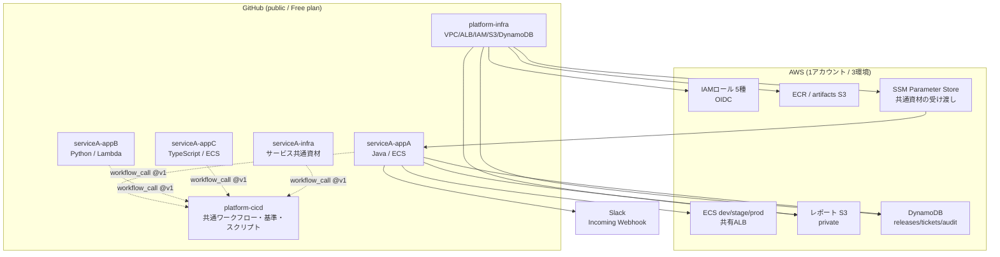
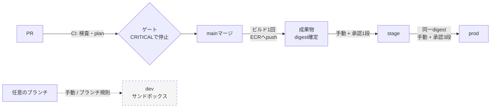
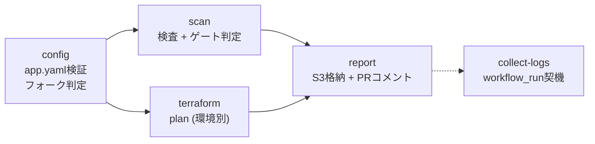
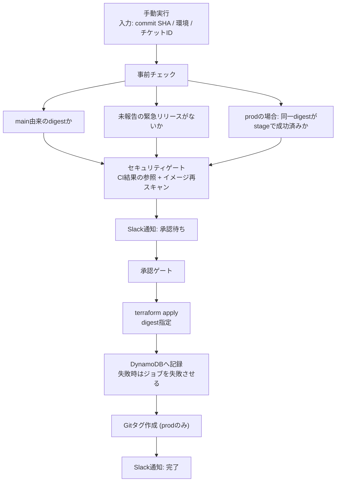

# 共通CI/CD基盤 設計書

| | |
|---|---|
| 版 | 0.1（実験フェーズ） |
| 最終更新 | 2026-10-04 |
| 状態 | 環境の定義・昇格モデル・ブランチ戦略は合意済み。CDは未実装 |
| 関連文書 | [要件定義書](requirements.md) / [ADR](adr/) |

---

## 1. この文書の目的

[要件定義書](requirements.md)で定義した要件を、**どう実現するか**を記述する。
判断の理由と却下した代替案は[ADR](adr/)にあり、本書では結論と構造を示す。

---

## 2. 全体像



### 設計の中心にある考え方

要件のG-01（**アプリチーム間のバラツキをなくす**）を実現する手段として、
次の3段構えを採る。

| 段 | 手段 | 具体例 |
|---|---|---|
| 1 | **書けない構造にする** | 処理を中央リポジトリに集約し、アプリ側は宣言のみ（ADR-0001） |
| 2 | **権限で守る** | IAMで規約を強制。守らないとAWSへのapplyが失敗する（ADR-0006） |
| 3 | **文書で示す** | 上の2つで表現できないものだけを規約として記述 |

**3（文書）に頼る範囲を最小にすることが設計方針である。** 文書は守られないことがあるが、
構造と権限は守らざるを得ない。

---

## 3. リポジトリ構成と責務

1アプリ1リポジトリ（ADR-0001）。

| リポジトリ | 責務 | 所有者 |
|---|---|---|
| `platform-cicd` | 共通ワークフロー、composite action、検査基準、承認ペルソナ定義、スクリプト | プラットフォーム |
| `platform-infra` | 全環境・全サービスで共有するAWSリソース（VPC、ALB、ECSクラスター、ECR、S3、DynamoDB、OIDC、IAMロール） | プラットフォーム |
| `serviceA-infra` | serviceA内のアプリで共通の資材（共有DB、SNSなど） | サービスチーム |
| `serviceA-appA/B/C` | アプリのコード、Dockerfile、アプリ固有のTerraform | アプリチーム |

### 3.1 アプリリポジトリが持つもの

```
serviceA-appA/
├── .platform/app.yaml                 宣言（7行）
├── .platform/security-exceptions.yaml 脆弱性の抑制（任意）
├── .github/workflows/ci.yml           共通CIを呼ぶ（10行）
├── .github/workflows/collect-logs.yml ログ格納を呼ぶ（10行）
├── src/ Dockerfile build.gradle.kts   アプリ本体
└── terraform/                         アプリ固有のインフラ
```

**CI/CDの処理は一切持たない。** これがNFR-01の実装である。

### 3.2 バージョン参照

```yaml
uses: moonlight4617/platform-cicd/.github/workflows/ci.yml@v1
```

タグで固定する（FR-03）。基盤側の変更で全アプリのCIが同時に壊れる事態を防ぐ。
`v1` タグを進める前に、`platform-cicd` のself-testが通ることを条件とする。

---

## 4. 環境の定義と昇格モデル

### 4.1 環境の役割

| 環境 | 役割 | 承認 | 昇格チェーン | ドリフト検知 |
|---|---|---|---|---|
| **dev** | 開発者が自由に動作確認するサンドボックス | なし | **含まれない** | **対象外** |
| **stage** | リリース前の確認環境 | 1段 | 起点 | 対象 |
| **prod** | 本番環境 | 3段 | 終点 | 対象 |

**devを昇格チェーンから外すことが、この設計の要点である。**

devはサンドボックスであり、状態は常に誰かの作業中コードである。
したがって「devで動いた」ことはprodで動くことの根拠にならない。
根拠になるのはstageでの確認だけである。

この整理により、devへ自由にデプロイできること（FR-53）と
成果物の同一性（FR-32）が両立する。

### 4.2 昇格モデル



| 段階 | 契機 | 成果物 | ゲート |
|---|---|---|---|
| CI | PR作成・更新 | ビルドのみ（pushしない） | セキュリティゲート（CRITICALで停止） |
| 成果物の確定 | mainへのマージ | **ECRへpush。digestを記録。デプロイはしない** | — |
| dev | 開発者の操作 | 任意（検証用） | なし |
| stage | 手動実行 | main由来のdigestのみ | セキュリティゲート（CRITICAL/HIGH）+ 承認1段 |
| prod | 手動実行 | **stageで成功した同一digest** | セキュリティゲート + 承認3段 |

### 4.3 成果物の同一性の担保（FR-32, FR-33）

3つの層で担保する。

| 層 | 手段 | 破れるか |
|---|---|---|
| 構造 | イメージタグではなく**digest**で指定する。タグは付け替え可能なため使わない | 破れない |
| 権限 | **ECRへのpushとartifacts S3への書き込みは devロールだけが持つ。** stage/prodロールは読み取りのみ | 破れない |
| 記録 | prodデプロイ前に「同一digestがstageで成功したか」をDynamoDBで検証する | 記録が欠けると止まる |

**2層目が効いている。** stage/prodのパイプラインは権限として新しいイメージを作れないため、
環境別ビルドが仕組みとして不可能になっている。

### 4.4 環境別設定の注入（ADR-0005）

成果物は環境に依存しない。環境差は実行時に注入する。

| 種類 | 注入元 | 例 |
|---|---|---|
| 実行時設定 | ECSタスク定義 / Lambda環境変数 | `SPRING_PROFILES_ACTIVE`, `SERVER_SERVLET_CONTEXT_PATH` |
| 秘密情報 | Secrets Manager / SSM SecureString | DBパスワード |
| 共通資材の参照 | SSM Parameter Store | VPC ID、ALBリスナーARN |

**例外規定**: ビルド時に埋め込まざるを得ない場合（SPAのバンドルなど）のみ、
`.platform/app.yaml` に `build_per_env: true` と明記して環境別ビルドを許可する。
その場合も**同一のcommit SHAからビルドし、prodはstage成功済みのSHAからのみ**ビルドできる。

---

## 5. 権限設計（AWS）

### 5.1 ロール構成（ADR-0006）

OIDCのみ。アクセスキーは発行しない。

| ロール | 引き受け条件（OIDC `sub`） | 主な権限 |
|---|---|---|
| `gha-ci` | 各リポジトリの `environment:ci` | 読み取り + レポート書き込み |
| `gha-deploy-dev` | 各リポジトリの `environment:dev` | devリソースの変更 + **ECR push** + artifacts書き込み |
| `gha-deploy-stage` | 各リポジトリの `environment:stage` | stageリソースの変更（ECR読み取りのみ） |
| `gha-deploy-prod` | 各リポジトリの `environment:prod`, `environment:prod-emergency` | prodリソースの変更（ECR読み取りのみ） |
| `gha-platform` | `platform-infra` の `environment:prod` のみ | 共有リソースとIAMの変更 |

**`sub` 条件はワイルドカードを使わず、リポジトリ×環境の完全一致で列挙する。**
これにより、prod環境のジョブ以外からprodロールを引き受けられない。
**承認ゲートを迂回したprodアクセスが権限として不可能になる（FR-25）。**

CIのplanも `environment: ci` を経由させ、**すべてのAWSアクセス経路を環境で固定する。**

### 5.2 1アカウント内での環境分離（CON-04）

アカウント境界がないため、次の3点で分離する。

| 手段 | 内容 |
|---|---|
| 命名規約 | `<service>-<app>-<env>[-suffix]` で統一 |
| タグ | 全リソースに `Environment` タグ |
| IAMポリシー | 名前パターンとタグ条件で操作を制限。環境をまたぐ変更は明示的にDeny |

**この分離の強度はIAMポリシーの正しさに依存する。** アカウント分離なら設定ミスでも
境界を越えられないが、その安全性は得られていない（D-01）。

実際、実装中に名前パターンの穴（`*-dev-*` が `/ecs/serviceA-appA-dev` に一致しない）が
3箇所見つかっている。**設計段階では見えず、リソース名を決めてはじめて分かる類の問題。**

### 5.3 アプリ側が守る必要がある規約

IAMがこれらを前提に権限を絞っているため、守らないとapplyが失敗する。

| 規約 | 守らないとどうなるか |
|---|---|
| リソース名を `<service>-<app>-<env>` にする | AccessDenied |
| 全リソースに `Environment` タグを付ける | AccessDenied（タグ条件に外れる） |
| ECSタスク定義の登録時にタグを付ける | AccessDenied（`RegisterTaskDefinition` はリソース制限に非対応のため `aws:RequestTag` で縛っている） |
| IAMロールを `/platform/<env>/` パス配下に作る | AccessDenied |
| S3レポートに `Kind` タグを付ける | Deny（ライフサイクルの判定に使うため） |
| ALBのリスナールール優先度はSSMの値を使う | 優先度の衝突でapply失敗 |

---

## 6. ブランチ戦略

### 6.1 方針

**ブランチ戦略はプラットフォーム全体で1つに固定し、アプリごとに設定できないようにする（FR-05）。**

アプリごとに選べる状態にすると、それ自体がチーム間のバラツキになる。
したがって `platform-cicd` 側の単一の設定として持ち、アプリの `app.yaml` では
上書きできない構造にする。

### 6.2 採用案（合意済み: 2026-10-10）

```
任意のブランチ  → 手動実行で dev へデプロイ（サンドボックス）
PR             → CI（検査 + plan）。デプロイしない
mainマージ      → 成果物のビルドとECRへのpush、digestの記録。デプロイしない
手動実行        → stage（承認1段）→ prod（承認3段）
```

| 論点 | 決定 | 理由 |
|---|---|---|
| devへのデプロイ契機 | **手動実行**（`workflow_dispatch` でブランチを指定） | 誰が何をdevに出したかが明示的に残る。ブランチpushでの自動デプロイは、軽微なpushごとにデプロイが走り、意図しないデプロイと待ち時間を生む |
| mainマージでdevへ自動デプロイするか | **しない** | devはサンドボックスであり、自動デプロイすると開発者の検証を上書きする。また「今のdevはお試しか正規か」という曖昧さが生まれる |
| stage/prodの契機 | 手動実行のみ | 「コードが変わった」と「出す判断をした」を分離する（ADR-0004） |
| 昇格チェーン | **`main → stage → prod`** | devは含まない。devで動いたことはprodで動くことの根拠にならない |

### 6.3 devへのデプロイの扱い

devはサンドボックスだが、**状態が分からないと調査ができない。** 次の2点を実装する。

| 項目 | 内容 |
|---|---|
| 記録 | devへのデプロイもDynamoDBに記録する（`env: dev`）。「今devに何が入っているか」を参照できる（FR-54） |
| 直列化 | `concurrency` でアプリ単位に直列化し、同時実行による中途半端な状態を防ぐ |

**devの記録は昇格判定には使わない。** 昇格判定（prodの事前チェック）が参照するのは
`env: stage` の成功記録のみである。

### 6.4 GitHubによる強制

GitHub Environmentsの「deployment branches」で、環境ごとにデプロイ元ブランチを制限する
（publicリポジトリのFree planで利用可能）。

| 環境 | 許可するブランチ |
|---|---|
| `dev` | 制限なし |
| `stage`, `prod-approval-*`, `prod` | `main` のみ |
| `prod-emergency` | `main` のみ |

**これによりmain以外からのstage/prodデプロイがGitHub側で不可能になる。**

---

## 7. CI設計

### 7.1 ジョブ構成



| ジョブ | 内容 | シークレット | フォークPR |
|---|---|---|---|
| `config` | `.platform/app.yaml` の読み込みと検証。不備があればここで落とす | 不要 | 実行する |
| `scan` | 静的解析・脆弱性診断。SARIFを収集してゲート判定 | 不要 | **実行する** |
| `terraform` | 環境ごとの `terraform plan` | 必要 | **スキップ** |
| `report` | レポートのS3格納、PRへの要約コメント | 必要 | **スキップ** |
| `collect-logs` | 実行ログの取得とS3格納（別ワークフロー） | 必要 | — |

**ジョブをシークレットの有無で分割している（ADR-0002）。** フォークからのPRでは
シークレットもOIDCも使えないため、検査だけは実行し、AWSに触る処理はスキップする。

### 7.2 検査ツール

| 種類 | Java | Python | TypeScript | 共通 |
|---|---|---|---|---|
| SAST | — | — | — | Semgrep, CodeQL |
| Lint | SpotBugs | ruff | ESLint | — |
| 依存ライブラリ | — | — | — | Trivy fs |
| コンテナイメージ | — | — | — | Trivy image |
| IaC | — | — | — | Trivy config |
| シークレット | — | — | — | gitleaks, Trivy secret |

**出力形式はSARIFに統一する（ADR-0008）。** ツールごとに形式が違うと、
判定ロジックがツール数に比例して増え、ツール追加のたびに基盤の改修が必要になる。

#### Trivyのみ自前変換する理由

ゲート基準は「CRITICAL/HIGH **かつ修正版が提供されているもの**」である。
Trivyの組み込みSARIF出力は `FixedVersion` を構造化して残さない（本文テキストに混ざる）ため、
この判定ができない。

そのため `scripts/trivy_to_sarif.py` でJSONから変換し、`properties.fixedVersion` を
保持したSARIFを生成する。**下流はSARIFだけを見れば済む状態を保つ。**

### 7.3 ゲート判定

```
SARIF群 → 深刻度の正規化 → 抑制の適用 → モード別の判定 → 要約 + 終了コード
```

#### 深刻度の決定順

1. `rule.properties["security-severity"]`（CVSSスコア。Trivy/CodeQLが付与）
2. `result.level`（error → HIGH、warning → MEDIUM、note → LOW）

#### モード別の停止条件

| モード | 停止させる深刻度 | 修正版の要求 |
|---|---|---|
| `pr` | CRITICAL | あり |
| `dev` | （停止させない） | — |
| `stage` | CRITICAL, HIGH | あり |
| `prod` | CRITICAL, HIGH | あり |

**修正版がないものを停止させないのは、修正手段がないままリリースが永久に
止まるのを防ぐため。** 検出自体はレポートに残る。

ただし**SASTの検出には修正版の概念がない**ため、判定不能なものは停止条件に含める
（`policy.yaml` の `fix_availability.unknown: block`）。コードを直す以外に手段がないため。

#### 常に停止させるもの

| 対象 | 理由 |
|---|---|
| gitleaksの検出 | シークレットはコミットされた時点で漏洩している。publicリポジトリでは特に致命的 |
| 有効期限切れの抑制 | 抑制の恒久化を防ぐ |
| 抑制の記載不備 | 理由・期限・承認者が欠けた抑制を許さない |
| 期限が上限（180日）を超える抑制 | 実質的な恒久化を防ぐ |

#### 抑制の宣言（FR-17）

```yaml
exceptions:
  - id: CVE-2025-12345
    reason: 該当機能を使用していないため影響なし
    expires: 2026-12-31      # 必須。最長180日先まで
    approved_by: sre         # 必須
    paths: ["build.gradle.kts"]
```

**基準そのもの（`policy.yaml`）はアプリ側から変更できない（FR-16）。**
アプリ側が持てるのは個別の抑制だけであり、それも期限付きである。

### 7.4 失敗を成功として扱わない（NFR-05）

次のすべてで明示的に失敗させる。

| 状況 | 動作 |
|---|---|
| スキャンツールがレポートを生成しなかった | ジョブを失敗させる |
| SARIFが壊れている | ゲート判定を異常終了させる |
| SARIFが1件も収集されなかった | ジョブを失敗させる |
| `policy.yaml` / 抑制ファイルの設定不備 | 「停止」とは区別して失敗させる |
| ログの取得に失敗した | ログ収集ワークフローを失敗させる |

**これらを通過として扱うと、検査していないことに気づけない。**

---

## 8. CD設計

### 8.1 ワークフロー構成

| ワークフロー | 契機 | 環境 | 承認 |
|---|---|---|---|
| `build-artifact.yml` | mainマージ | `build` | なし |
| `deploy-dev.yml` | 手動実行 | `dev` | なし |
| `release-stage.yml` | 手動実行 | `ci` → `stage` | 1段（dev_lead） |
| `release-prod.yml` | 手動実行 | `ci` → `prod-approval-1/2/3` → `prod` | 3段 |
| `emergency-release.yml` | 手動実行 | `ci` → `prod-emergency` | 1段（SRE） |
| `drift-detection.yml` | 定期実行（1日1回・深夜） | `ci` | なし |

stageとprodを別ワークフローにしたのは、prodの3段承認とstageの1段承認を
1つのワークフローで条件分岐させると、ジョブの依存関係（スキップされた
ジョブを待つ扱い）が複雑になり、**承認を飛ばす事故の余地が生まれる**ため。
重複するのは事前チェックの呼び出し部分だけであり、処理はcomposite actionに
集約されている。

`build` 環境を独立させたのは、ECRへのpush権限を持つロール（`gha-deploy-dev`）を
引き受ける文脈を「devへのデプロイ」と「成果物のビルド」で分けるため。
OIDCの `sub` 条件には `environment:build` と `environment:dev` の両方を列挙している。

### 8.2 release-prod.yml の流れ



### 8.3 事前チェック（FR-33）

prodリリース時に次を検証し、1つでも満たさなければ停止する。

| チェック | 根拠 |
|---|---|
| 指定されたdigestがmain由来であること | 成果物の出自を保証 |
| 同一digestがstageで成功していること | stageを飛ばしたリリースを防ぐ |
| 同一アプリに未報告の緊急リリースがないこと | 事後報告の強制（FR-35） |
| セキュリティゲートを通過すること | 新規公表の脆弱性を含めて再確認 |

### 8.4 セキュリティゲート（stage/prod）

CIの結果だけに頼らず、**イメージを再スキャンする。** CI通過時点と
リリース時点には時間差があり、その間に公表された脆弱性を見逃すため。

- CI結果: S3の `<service>/<app>/ci/<commit_sha>/` から取得
- 再スキャン: ECR上のイメージに対して `trivy image`

### 8.5 承認ゲート（FR-20〜FR-22）

承認判定の正本は**GitHub Environmentsの Required reviewers**。

```
stage : stage環境（承認者 dev_lead）
prod  : prod-approval-1 (dev_lead) → prod-approval-2 (qa_po)
        → prod-approval-3 (sre) → prod（承認なし。実行用）
```

**段数を「環境の直列」で表現する理由（FR-22）**:
1つの環境に3人を登録すると、GitHubの仕様上「登録者のうち誰か1人の承認」で
通過してしまい、3段階の承認にならない。

**DynamoDBは判定に使わず、記録と参照に限定する。** 正本を2つにすると
食い違う状態が必ず発生する。

**実験での割り切り（D-03）**: 承認者が1アカウントのため、
「自分のデプロイを自分でレビューさせない」設定をOFFにする必要がある。
実務では必ずONにする。

### 8.6 緊急リリース（FR-34, FR-35）

| 項目 | 内容 |
|---|---|
| 承認 | 1段（SRE） |
| 入力 | 対象digest、インシデントID、理由（すべて必須） |
| セキュリティゲート | **スキップする**（結果の記録は行う） |
| 記録 | `emergency: true`, `postmortem_filed: false` |
| 強制 | **未報告の緊急リリースがある間、同一アプリの通常prodリリースをブロックする** |
| 例外 | 緊急リリース経路は再度使える（障害の連鎖時に復旧手段を封じないため） |

催促通知ではなくブロックを選んだ理由: **通知は無視できる。** 事後報告は
「重要だが急ぎではない」タスクなので、次の通常リリースが止まる状態を作る。

### 8.7 ロールバック

| 経路 | 内容 |
|---|---|
| 通常 | `release.yml` で過去のdigestを指定し、承認3段を通す |
| 緊急 | `emergency-release.yml` で過去のdigestを指定し、承認1段 |

ECSの `deployment_circuit_breaker`（`rollback = true`）により、
デプロイ失敗時はECS側で自動的に戻る。

---

## 9. AWS構成

### 9.1 ネットワーク（ADR-0013）

```
VPC (10.20.0.0/16) — 3環境で共有
├── パブリックサブネット × 2 AZ
├── ALB × 1（3環境 × 全ECSアプリで共有）
│   └── リスナー :80
│       ├── /dev/appA/*    → serviceA-appA-dev
│       ├── /stage/appA/*  → serviceA-appA-stage
│       ├── /prod/appA/*   → serviceA-appA-prod
│       └── /{env}/appC/* ...
└── ECSクラスター × 3（環境ごと）
```

| 項目 | 構成 | 実務での想定 |
|---|---|---|
| ALB | 1台をパス振り分けで共有 | 環境ごとに1台、ホスト名振り分け |
| サブネット | パブリック（`assign_public_ip = true`） | プライベート + VPCエンドポイント |
| NAT Gateway | なし | 必要に応じて |
| HTTPS | なし（ドメイン未保有） | ACM証書 + HTTPS |

**ALBはパスを書き換えられないため、アプリ側が接頭辞を認識する必要がある。**
接頭辞は実行時に `SERVER_SERVLET_CONTEXT_PATH` として注入する。
本来アプリはデプロイ先のパス構造を知るべきではなく、**実験構成のための不自然さが
アプリのコードに入り込んでいる。**

#### リスナールール優先度の採番

ALBを共有するため、優先度が衝突するとapplyが失敗する。
アプリ側に採番を任せると必ず衝突するため、`platform-infra` が採番してSSMで配布する。

```
priority = 100 + (アプリの並び順 × 10) + (環境の並び順)
```

### 9.2 Terraform構成（ADR-0007）

| 項目 | 構成 |
|---|---|
| state | S3。キーは `<service>/<app>/<env>/terraform.tfstate` |
| ロック | S3ネイティブロック（`use_lockfile`）。Terraform 1.10以上が必要 |
| 環境の分離 | stateのキーで分ける。**workspaceは使わない**（CLIの暗黙状態になり誤applyの危険があるため） |
| 環境別の値 | `env/<env>.tfvars` |
| バケット名 | コードに書かず `-backend-config` で渡す（ADR-0002） |

#### デプロイもTerraformで行う理由

デプロイツールとTerraformが同じタスク定義を書き換える構成にすると、
`terraform plan` の差分が常態化し、**本当のドリフトと区別できなくなる。**
ドリフト検知（FR-40）を要件とする以上、リソースの所有者を一元化する必要がある。

トレードオフ: デプロイのためにIAM・ネットワークまで変更できる権限を使うことになり、
**権限が必要以上に広い。**

#### CIのplanは `-lock=false`

ロック取得にはS3への書き込みが必要だが、CIロールは読み取り専用のため。
planは状態を変更しないのでロックなしで問題ない。

### 9.3 リポジトリ間のインターフェース（ADR-0014）

`terraform_remote_state` は使わず、**SSM Parameter Store**を経由する。

```
/platform/<env>/vpc_id
/platform/<env>/app_subnet_ids
/platform/<env>/app_security_group_id
/platform/<env>/alb_listener_arn
/platform/<env>/ecs_cluster_name
/platform/<env>/<service>-<app>/path_prefix
/platform/<env>/<service>-<app>/listener_rule_priority
/platform/<env>/<service>-<app>/ecr_repository_url
/<service>/<env>/<key>              サービス共通資材
```

| 理由 | 内容 |
|---|---|
| 結合が弱い | 公開されるのは「パラメータ名」という契約だけ。書き込み側の内部構造を変えても読み取り側が壊れない |
| 権限を絞れる | `terraform_remote_state` は読み取り側にstateバケットへの読み取り権限を要求する |
| 依存を作らない | パイプライン上の待ち合わせを実装しない。パラメータ不在時にplanが失敗することで順序の問題を検知する |

**初回構築のみ順序が必要**: `platform-infra` → `serviceA-infra` → 各アプリ。

---

## 10. データモデル

### 10.1 DynamoDB（ADR-0010）

| テーブル | キー | 用途 |
|---|---|---|
| `releases` | `release_id` | リリース履歴。**昇格判定の正本** |
| `tickets` | `ticket_id` | 擬似チケット |
| `approval_audit` | `release_id` + `occurred_at` | 承認イベントの時系列（追記専用） |

`releases` の主な属性:

| 属性 | 内容 |
|---|---|
| `app_key` | `<service>#<app>`（GSIのハッシュキー） |
| `env` | dev / stage / prod |
| `commit_sha` | 成果物の出自 |
| `image_digest` | 成果物の識別。`build_per_env` の場合は環境ごとのmap |
| `git_tag` | prodリリース時に付与（例 `appA/v1.4.0`） |
| `ticket_ids` | 紐づいたチケット |
| `approvals` | ゲートごとの承認者と日時 |
| `scan_report_s3` | レポートの場所 |
| `result` | success / failed / rolled_back |
| `emergency` / `postmortem_filed` | 緊急リリースの状態 |

GSI `app-deployed-index`（`app_key` + `deployed_at`）で次を引く。

- このアプリの最新リリース
- stageで成功済みのdigest一覧（prodの事前チェック）
- 事後報告が未完了の緊急リリース

**`dynamodb:DeleteItem` はデプロイロールに与えない。** 監査記録のため。

#### 書き込み失敗時の扱い

**リリース記録の書き込み失敗は、デプロイの失敗として扱う**（リトライ3回）。

記録のない成功を作らないため。記録が欠けた状態を成功として通すと、
次のprodリリースで「stageを通っていない」と判定され、原因不明のまま止まる。

**懸念（意図した副作用）**: AWSリソースは更新済みなのにジョブが赤になるため、
実行者が「デプロイは成功したのか」を自分で確認する必要がある。

### 10.2 S3（ADR-0009）

| バケット | 用途 |
|---|---|
| `<prefix>-tfstate` | Terraform state |
| `<prefix>-cicd-reports` | スキャンレポート、terraform plan、実行ログ |
| `<prefix>-cicd-artifacts` | Lambda成果物（zip） |

レポートのキー構造:

```
<service>/<app>/<ci|dev|stage|prod>/<commit_sha>/<run_id>/
  ├── reports/     SARIF、ゲート判定の要約
  ├── terraform/   plan.txt, plan.json
  └── logs/        ワークフローの実行ログ（zip）
```

| 種類 | `Kind` タグ | 保持期間 |
|---|---|---|
| レポート・plan | `reports` | 400日 |
| 実行ログ | `logs` | 90日 |

**`Kind` タグの付与はIAMで強制している**（未付与はDeny）。
タグがないとライフサイクルの対象外になり、レポートが残り続ける。

#### 実行ログの収集

GitHub Actionsのログは実行中のジョブからは取得できない（CON-06）。
`workflow_run`（completed）を契機とする別ワークフローでAPIから取得する。

**CI本体の成否とログ保存の成否が分離する**ため、ログ収集だけが失敗した場合に
気づきにくい。失敗時はSlack通知する。

---

## 11. セキュリティ設計

### 11.1 publicリポジトリでの機密の扱い（ADR-0002）

| 出力先 | 公開範囲 | 対策 |
|---|---|---|
| リポジトリ | 全世界 | 機密を置かない。GitHub Secretsから渡す |
| Actionsログ | **全世界** | `::add-mask::` で伏せる。`aws-auth` actionが認証前に強制 |
| Artifact | **全世界（誰でもダウンロード可）** | **レポートもplan全文も置かない** |
| PRコメント | 全世界 | 要約のみ。`redact.py` で伏せ字処理（二重の保険） |
| private S3 | AWS権限保持者 | 全文を格納 |

対策の内容:

1. アカウントID・ロールARN・バケット名はGitHub Secretsに置く
2. Terraformのコードにアカウントを書かない（`data.aws_caller_identity` で取得）
3. 各ジョブの先頭でアカウントIDをマスクする
4. plan全文・レポート・ログはprivate S3にのみ置く
5. ローカル開発用の値は `local/` に置き、git管理外にする

**残っているリスク**: 設定を1か所ミスするとログに出て公開される。
対策3と4が二重の保険だが、リスクはゼロにならない。

### 11.2 CIロールの権限（残したリスク）

CIロールには `ReadOnlyAccess` を付けている。
**このためPRのCIから全環境のtfstateファイルをS3経由で読める。prod環境のstateも含む。**

| | |
|---|---|
| 採用理由 | 読み取りアクションを列挙する方式ではplanが権限不足で落ちるリスクが高い |
| 緩和 | `secretsmanager:GetSecretValue` と `kms:Decrypt` を明示Deny。stateの書き込みは不可 |
| 緩和できていない点 | state自体の読み取り。PRを作れる人はワークフローを書き換えてstateを外部に送り出せる |
| 実務での対応 | 読み取りアクションの列挙 + stateに機密を置かない設計 |

**「CIは読み取り専用だから安全」という理解は誤り。**

### 11.3 フォークからのPR

| 項目 | 動作 |
|---|---|
| シークレット・OIDC | 利用不可 |
| 検査ジョブ | 実行する（シークレット不要） |
| AWSに触るジョブ | スキップする |
| `workflow_run` での扱い | デフォルトブランチをチェックアウトする（特権コンテキストで信頼できないコードを扱わない） |

リポジトリ設定で「外部コントリビューターのワークフロー実行に承認を要求する」を有効にする。

---

## 12. 運用設計

### 12.1 ドリフト検知（FR-40〜FR-43）

| 項目 | 内容 |
|---|---|
| 契機 | 定期実行（1日1回・深夜）+ PRのCI |
| 対象 | `serviceA-infra` と各アプリの `stage` / `prod`。**devは対象外**（サンドボックスのため） |
| コマンド | `terraform plan -detailed-exitcode -refresh-only` |
| 検知時 | plan結果をS3へ → GitHub Issueを自動作成 → Slack通知 |
| CIでのapply | **行わない** |

深夜にする理由: 日中の変更作業中の中間状態を差分として拾わないため。

#### 対応の3択（人間が判断）

| 判断 | 操作 |
|---|---|
| コードの状態に戻す | `release.yml` を実行し、承認ゲートを通してapply |
| 実態を正とする | コードを修正するPR。既存リソースの取り込みは `import` ブロックを追加したPR |
| 意図した差分として無視 | Issueに理由を記載して閉じる |

**importは必ずPR経由とする。** `terraform import` の直接実行は記録に残らず、
レビューも通らない。

### 12.2 通知（ADR-0015）

Incoming Webhookのみ。**通知は一方向で、承認操作はSlackから行わない。**
承認判定の正本をGitHubに置いているため、Slackに操作を持たせると判定経路が2つになる。

| 場面 | 内容 |
|---|---|
| 承認待ち | ペルソナへのメンション、対象、commit SHA、**承認画面のURL** |
| デプロイ成功 / 失敗 | 対象、環境、実行者、ログへのリンク |
| 脆弱性によるCD停止 | 検出件数、レポートへのリンク |
| ドリフト検知 | 差分件数、IssueのURL |
| 緊急リリース実行 | 実行者、理由、インシデントID |
| 事後報告の催促 | 未報告の一覧 |

**通知本文にARN・アカウントID・リソース名を含めない。** Slackは転送・
スクリーンショットされやすいため、リンク先で確認させる。

承認者のSlack IDは `config/approvers.yaml` で解決する。
**未設定の場合は「メンションできない」ことを通知本文に明示する。**
黙って届かない状態を作らないため。

### 12.3 基盤自身の保守

| 項目 | 内容 |
|---|---|
| self-test | `platform-cicd` のpush/PRでゲート判定テスト・YAML構文・設定整合性を検証 |
| バージョンタグ | `v1` を進める前にself-testの通過を条件とする |
| ツールバージョン | `config/tool-versions.env` で固定（**現状未固定**） |

---

## 13. 要件とのトレーサビリティ

| 要件 | 設計箇所 | ADR | 実装 |
|---|---|---|---|
| FR-01〜04 | 3章 | 0001 | 済 |
| FR-05 | 6.1 | 0004 | 済（設定ファイルを持たず、ワークフロー構造で固定） |
| FR-10〜14 | 7.2, 10.2 | 0008, 0009 | 済 |
| FR-15 | 8.4 | 0008 | 済 |
| FR-16, 17 | 7.3 | 0008 | 済 |
| FR-18 | — | 0016 | 保留 |
| FR-20〜22 | 8.5 | 0003 | 済 |
| FR-23 | 12.2 | 0015 | 済 |
| FR-24 | 10.1 | 0010 | 済 |
| FR-25 | 5.1 | 0006 | 済 |
| FR-30, 31 | 10.1 | 0010 | 済 |
| FR-32 | 4.3 | 0005 | 済 |
| FR-33 | 8.3 | 0004, 0010 | 済（テストで固定） |
| FR-34, 35 | 8.6 | 0011 | 済（テストで固定） |
| FR-40〜43 | 12.1 | 0012 | 済 |
| FR-50, 51 | 7.1 | 0004 | 済 |
| FR-52, 53, 54 | 6.2, 6.3 | 0004 | 済 |
| FR-60 | — | 0016 | 保留 |
| NFR-01 | 3.1 | 0001 | 済 |
| NFR-02〜04 | 11.1, 5.1 | 0002, 0006 | 済 |
| NFR-05 | 7.4 | 0008 | 済 |
| NFR-06 | 12.3 | 0008 | **未**（バージョン未固定） |
| NFR-07 | 10.1 | 0010 | 済 |
| NFR-08 | 9.1 | 0013 | 済 |
| NFR-09 | 3.2 | 0001 | 済 |
| NFR-10 | 12.3 | — | 済 |

---

## 14. 実装状況（2026-10-10）

| リポジトリ | 状態 | 検証 |
|---|---|---|
| `platform-infra` | 実装済み・**未apply** | `terraform validate` 成功、bootstrapの`plan`成功 |
| `platform-cicd`（CI） | 実装済み | ゲート判定テスト23項目PASS |
| `platform-cicd`（CD） | 実装済み | リリース判定テスト12項目PASS、YAML28件OK |
| `serviceA-appA` | 実装済み・**未デプロイ** | `terraform validate` 成功。**Gradleビルドは未検証** |
| `serviceA-appB/C`, `serviceA-infra` | 未着手 | — |

### テストで固定している判定

| 内容 | テスト |
|---|---|
| CRITICALかつ修正版ありのみPRで停止する | `test_gate.py` |
| 修正版がない脆弱性ではリリースを止めない | `test_gate.py` |
| 抑制の期限切れ・記載不備・期限超過を検出する | `test_gate.py` |
| 壊れたSARIFを「問題なし」として通さない | `test_gate.py` |
| **devでのみ成功したdigestはprodへ出せない** | `test_release_store.py` |
| main以外から作られた成果物はリリースできない | `test_release_store.py` |
| 未報告の緊急リリースがあると通常リリースが止まる | `test_release_store.py` |
| 緊急リリース経路は未報告があっても使える | `test_release_store.py` |

### 実機検証で判明した問題（15章）

設計・コードレビュー・ローカルテストでは検出できず、**実際に動かしてはじめて
判明した問題が5件**ある。詳細は15章。

### 未検証の重要項目

| 内容 | 理由 |
|---|---|
| 承認ゲートの実動作 | stage/prodへのリリースを未実行 |
| ECSへの実デプロイ | CIが通るまで未実行 |
| Slack通知の実配信 | Webhook URLが未設定 |

---

## 15. 実機検証で判明した問題

**この基盤は、実際に動かさずに正しさを主張できない。** 以下はすべて
`terraform validate`・YAML構文チェック・ユニットテストを通過したうえで、
実行時に失敗したものである。

| # | 問題 | 検出された場所 | 原因 |
|---|---|---|---|
| 1 | IAMのリソースパターンが実際のリソース名に一致しない | appAのTerraform作成時 | `*-<env>-*` は `/ecs/serviceA-appA-dev` のように環境名で終わる名前に一致しない。ロググループ・タスク定義・Lambda関数の3箇所 |
| 2 | ECRのリポジトリ名は小文字のみ | `platform-infra` のapply | 命名規約 `<service>-<app>` は `serviceA-appA` のように大文字を含む |
| 3 | 再利用可能ワークフローでOIDCが使えない | CIの初回実行 | ワークフローレベルの `permissions: contents: read` がGITHUB_TOKENの上限になる。OIDCを使うジョブに `id-token: write` をジョブレベルで明示する必要がある |
| 4 | SpotBugs 6.xでタスクの生成に失敗 | CIのスキャンジョブ | 既定のレポートが登録されていないため `reports.named("xml")` の参照で `SpotBugsReport with name 'xml' not found` |
| 5 | Spring Boot 4でテストのパッケージが移動 | ビルド | `AutoConfigureMockMvc` が `org.springframework.boot.test.autoconfigure.web.servlet` に存在しない |
| 6 | **OIDCの sub が不変サブジェクト形式** | CIのAWS認証 | GitHubは `use_immutable_subject: true` が既定で、subに**オーナーIDとリポジトリIDが含まれる**（`repo:owner@70841616/repo@1413353244:environment:ci`）。名前ベースの信頼ポリシーは一切一致しない |
| 7 | **Javaの依存ライブラリがスキャンされていなかった** | CIのスキャン結果 | `trivy fs` はロックファイルを見て依存を解決する。Gradleでロックファイルを使っていないと**検出0件**になり、「検出なし」が「脆弱性なし」に見える |
| 8 | `ecs:DeregisterTaskDefinition` がリソースレベル権限に非対応 | IAMポリシーシミュレータ | ARNを指定するとどのパターンでも `implicitDeny`。`*` で許可し、環境の制限はタグ条件で行う必要がある |
| 9 | **自分で設定したIAM Denyが自分のアップロードを阻んだ** | CIのレポート格納 | `aws s3 cp` はアップロード時にタグを付けられない。`Kind` タグ必須のDenyにより PutObject が拒否される。「上げてから後でタグを付ける」構成は成立しない |

### 7番が最も重要

CIは**成功したまま**「脆弱性0件」を報告し続けていた。ADR-0008で
「失敗を問題なしとして通さない」（NFR-05）を掲げていたが、
**「スキャン対象が存在しないこと」は検出できていなかった。**

対策として、CIでコンテナイメージをビルドし（pushはしない）、
`trivy image` で実際に同梱される依存ライブラリをスキャンする形に変更した。

| | 検出件数 |
|---|---|
| 変更前（`trivy fs` のみ） | 0件 |
| 変更後（`trivy image` 追加） | 22件（CRITICAL 3 / HIGH 13 / MEDIUM 5 / LOW 1） |

さらに、Javaでロックファイルもイメージも無い場合は**明示的に失敗させる**ようにした。

### 6番への対応方針

不変サブジェクトは**リポジトリの改名・削除・再作成に対する耐性**を持たせる仕組みであり、
セキュリティ上望ましい。そのため回避せず、オーナーIDとリポジトリIDを
明示する形に変更した。

`repo_id` が未設定（まだGitHub上に作成していない）リポジトリには
AWSへのアクセスを許可しない。リポジトリを作り直した場合は、
IDを更新して信頼関係を張り直す必要がある。

### IAMポリシーシミュレータが有効だった

`aws iam simulate-principal-policy` による事前検証で8番を検出できた。
同時に「**dev用ロールがprodのstateに書き込めない**」ことも確認でき、
1アカウント内の環境分離（ADR-0006）が実際に機能していることの裏付けになった。

```
s3:PutObject  .../serviceA/appA/dev/terraform.tfstate   allowed
s3:PutObject  .../serviceA/appA/prod/terraform.tfstate  implicitDeny
```

### 構造的に予見できた問題

次の1件は設計から導けたもので、実機検証の前に自分で気づいて対処した。

| 問題 | 内容 |
|---|---|
| `image_digest` のvalidationがCIのplanを壊す | stage/prodで `image_digest` を必須にすると（ADR-0005をvalidationで強制）、デプロイではないCIのplanが通らない。DynamoDBから「その環境にデプロイされている成果物のdigest」を引いて渡すことで解決した。固定のダミー値だとplanに毎回差分が出てレビュー価値が落ちる |

### この結果から言えること

- **IAMの名前パターンとタグ条件は、実際のリソース名を決めてapplyするまで検証できない。**
  1アカウント構成（ADR-0006）で分離の強度がIAMポリシーの正しさに依存している以上、
  実機検証は省略できない。
- **再利用可能ワークフローのpermissionsの挙動は、実行するまで分からない。**
  ジョブ単位で `id-token: write` を明示する規約を基盤側に持つ必要がある。
- ツールやライブラリのバージョンは、存在確認だけでは不十分で、
  実際にビルドして初めてAPIの差異が分かる。
